# Issue Tracker: an end-to-end DevOps capstone

**Name:** Rajveer Bishnoi
**Enrollment Number:** 24BCS10404
**Roll Number:** 10404

An issue tracker (React front end, FastAPI back end, PostgreSQL) taken from a developer laptop to
a monitored Kubernetes deployment, with every layer of the course applied to the same application:
version control, CI with tests and image scanning, a container registry, Kubernetes with Helm,
Ingress, an autoscaler and probes, Prometheus and Grafana, GitOps with Argo CD, Terraform for the
cloud network, and a troubleshooting drill with planted faults.

The application code and its Dockerfiles live in
[Issue Tracker Compose](../Issue%20Tracker%20Compose/). This folder holds everything that deploys
and operates it.

## Contents

| § | Section |
|---|---|
| 1 | [Architecture](#1-architecture) |
| 2 | [Tech stack](#2-tech-stack) |
| 3 | [Repository layout](#3-repository-layout) |
| 4 | [Application and API](#4-application-and-api) |
| 5 | [Local setup (Docker Compose)](#5-local-setup-docker-compose) |
| 6 | [Testing and code quality](#6-testing-and-code-quality) |
| 7 | [CI/CD pipeline (GitHub Actions)](#7-cicd-pipeline-github-actions) |
| 8 | [DevSecOps: Trivy image scanning](#8-devsecops-trivy-image-scanning) |
| 9 | [Infrastructure as Code: Terraform](#9-infrastructure-as-code-terraform) |
| 10 | [Kubernetes and Helm deployment](#10-kubernetes-and-helm-deployment) |
| 11 | [GitOps with Argo CD](#11-gitops-with-argo-cd) |
| 12 | [Observability: Prometheus and Grafana](#12-observability-prometheus-and-grafana) |
| 13 | [Troubleshooting drill](#13-troubleshooting-drill) |
| 14 | [Known issues and limitations](#14-known-issues-and-limitations) |
| 15 | [Screenshot index](#15-screenshot-index) |

## 1. Architecture

```
developer ── git push ──> GitHub ──> GitHub Actions
                                       ├─ pytest + frontend build
                                       ├─ docker build (backend, frontend)
                                       ├─ Trivy scan, fail on HIGH/CRITICAL with a fix
                                       ├─ push ghcr.io/rajveer42/issue-tracker-{backend,frontend}:<sha>
                                       └─ helm upgrade --install on a kind cluster + smoke test
                     │
                     └──────────────> Argo CD (in the cluster) watches helm/issue-tracker on main
                                                         │ sync
   browser ──> Ingress (nginx) ──┬── /     ──> frontend Service ──> nginx Pods (x3)
     tracker.local               └── /api  ──> backend  Service ──> FastAPI Pods (2..5, HPA)
                                                                        │
                                                      Prometheus scrapes /metrics ──> Grafana
                                                                        │
                                                            postgres StatefulSet + PVC
```

Two paths are worth reading separately: how a commit becomes a running image, and how a browser
request reaches the database. The Ingress is the only way in; postgres has no Service exposed
outside the namespace and no NodePort.

## 2. Tech stack

| Layer | Used |
|---|---|
| Application | React 18 + Vite, FastAPI, SQLAlchemy 2, Alembic, PostgreSQL 16, pytest |
| Containers | Multi-stage Dockerfiles, non-root users, nginx-unprivileged, Docker Compose |
| CI/CD | GitHub Actions, GHCR, Trivy, Helm, kind |
| Kubernetes | Minikube (Docker driver), ingress-nginx, metrics-server, Helm |
| Observability | `prometheus_client` in the app, Prometheus, Grafana |
| GitOps | Argo CD |
| Infrastructure | Terraform, AWS provider, LocalStack |

## 3. Repository layout

```
Final DevOps Project/
├── kubernetes/namespace.yaml      the namespace, applied once
├── helm/issue-tracker/            the chart: postgres StatefulSet+PVC, backend, frontend,
│   │                              Ingress, HPA, ConfigMap, Secret
│   ├── values.yaml                defaults (Minikube)
│   ├── values-dev.yaml            single replicas, no HPA
│   └── values-prod.yaml           3+ replicas, external Secret, registry pull policy
├── monitoring/                    Prometheus (annotation discovery, alert rules),
│                                  Grafana (provisioned dashboard), load-test.sh
├── gitops/application.yaml        Argo CD Application tracking the chart in this repo
├── security/README.md             what each stage enforces and why
├── terraform/README.md            where the cloud pieces are, and why EKS was not run
├── troubleshooting/               two planted faults, their diagnosis, fixes and captures
├── demo/                          the presentation deck and the demo recording
└── screenshots/
```

The workflow itself is at the repository root: `.github/workflows/issue-tracker-cicd.yml`.

## 4. Application and API

Nine endpoints, three of them operational:

| Method | Path | Purpose |
|---|---|---|
| `GET` | `/health` | Liveness. Answers from the process alone, touches no dependency. |
| `GET` | `/ready` | Readiness. Executes a query, so a database problem removes the Pod from the Service. |
| `GET` | `/metrics` | Prometheus exposition. |
| `GET` | `/api/issues` | List, filterable by status. |
| `GET` | `/api/issues/stats` | Counts by status and priority, plus open-and-high. |
| `GET` | `/api/issues/{id}` | Fetch one. |
| `POST` | `/api/issues` | Create. Rejects a priority outside low/medium/high. |
| `PUT` | `/api/issues/{id}` | Update. |
| `DELETE` | `/api/issues/{id}` | Delete. |

The split between `/health` and `/ready` is the part worth explaining. A liveness probe that
queried the database would restart a perfectly healthy Pod every time the database blinked, turning
a brief dependency problem into a restart loop. `/ready` is the one that checks the database, so the
Pod is pulled out of the Service and put back when the database returns.

Schema changes are Alembic migrations; the backend runs `alembic upgrade head` on start, so a fresh
database and an existing one converge to the same place.

## 5. Local setup (Docker Compose)

```bash
cd "Issue Tracker Compose"
docker compose up -d --build

# the UI
open http://localhost:8080
# the API directly
curl -s localhost:8011/health
curl -s localhost:8011/api/issues/stats
```

Three services. `postgres` must report healthy before the backend starts, because the backend runs
its migrations immediately. The frontend's nginx proxies `/api` to the backend, so the browser only
ever talks to port 8080 and there is no CORS configuration anywhere.

Tear down with `docker compose down -v` (the `-v` drops the database volume).

## 6. Testing and code quality

Eight pytest cases run against a real FastAPI app with a SQLite session per test: the
create/read/update/delete cycle, rejection of an invalid priority, listing and filtering, the stats
aggregation, readiness actually hitting the database, and the metrics counter incrementing when an
issue is created.

```
collected 8 items
8 passed, 1 warning in 0.11s
```

Tests run as the first job in the pipeline. No image is built until they pass, so a red test can
never produce a pushed tag.

## 7. CI/CD pipeline (GitHub Actions)

`issue-tracker-cicd.yml`, triggered by pushes touching the application or this folder:

1. **backend tests** (pytest, JUnit artifact) and **frontend build** (Vite, `dist` artifact), in parallel.
2. **images**, a matrix over `backend` and `frontend`: build with buildx and a per-service cache,
   **Trivy** scan, JSON report as an artifact, then push to GHCR tagged with the seven-character git
   SHA. Pull requests stop before the push.
3. **deploy**: a kind cluster inside the runner, the namespace, a pull secret minted from the run's
   own token, `helm upgrade --install` with the tag that was just pushed, then a smoke test from
   inside the cluster through the frontend Service.

The smoke test is the part that makes the job meaningful. It does not just check that the release
installed; it creates an issue through nginx, reads the stats back, and asserts the metrics counter
moved — exercising nginx, the backend and postgres in one pass.

```
NAME: tracker          STATUS: deployed        REVISION: 1
{"status":"ready"}
{"title":"created by CI","status":"open","priority":"high","id":1}
{"total":1,"by_status":{"open":1,"in_progress":0,"done":0},"open_high_priority":1}
tracker_issues_created_total 0.0
```

Reference run: [38892471244](https://github.com/RAJVEER42/DevOps/actions/runs/38892471244) on commit
`17ee1b0`, publishing `ghcr.io/rajveer42/issue-tracker-backend:17ee1b0` and
`ghcr.io/rajveer42/issue-tracker-frontend:17ee1b0`. All five jobs green.

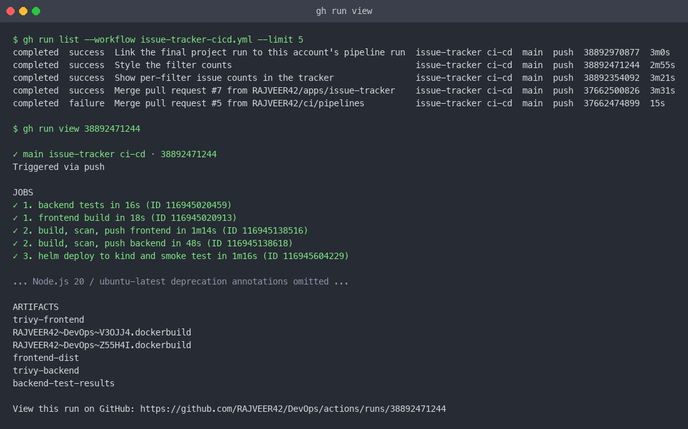
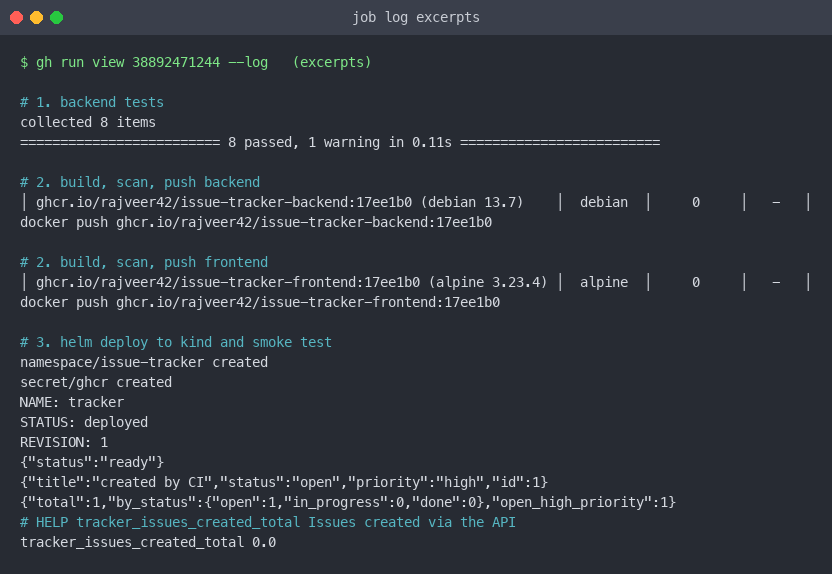

## 8. DevSecOps: Trivy image scanning

Policy, applied identically to both images:

```
severity:        HIGH,CRITICAL
ignore-unfixed:  true      # a CVE with no patch available is reported, not blocking
exit-code:       1         # anything else fails the job before the push step
```

The reasoning: a vulnerability that can be cleared by bumping a version should block the build,
because the fix is cheap. One with no fix available anywhere should be visible but should not freeze
every release. A gate that blocks on things nobody can fix is a gate people switch off.

### What the scan found, and how it was fixed

The scanner failed the build twice before it passed, and both failures were in dependencies rather
than in project code.

The **frontend** image failed on fixable HIGH and CRITICAL findings in its Alpine base layer —
nothing in the application, the base image was simply behind. The fix was to move to
`nginxinc/nginx-unprivileged:1.29-alpine` and run `apk upgrade --no-cache` at build time, which also
got the image a non-root default. The backend's Debian stage gained `apt-get upgrade` for the same
reason.

The **backend** image then failed on Starlette, the ASGI layer underneath FastAPI, which the pinned
FastAPI version would not allow pip to upgrade past. Bumping FastAPI alone was not enough; the
version it pulled still carried findings. Moving to `fastapi==0.142.2` with `starlette==1.7.0`
pinned explicitly cleared them, and the tests still passed.

Both fixes are in the committed dependency and image definitions, and the current scan result on
both images is zero fixable HIGH or CRITICAL findings:

```
ghcr.io/rajveer42/issue-tracker-backend:17ee1b0   (debian 13.7)     0
ghcr.io/rajveer42/issue-tracker-frontend:17ee1b0  (alpine 3.23.4)   0
```

That is the scanner doing its job: a release carrying a vulnerable base image or a vulnerable
library never reached the registry, and each fix was a one-line version change.

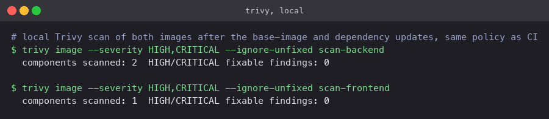

Layer-by-layer controls are listed in [security/README.md](security/README.md): tests gate the
build, Trivy gates the push, images run as non-root with capabilities dropped, the database is never
exposed, the registry is private with a short-lived pull token, and `values-prod.yaml` expects the
database Secret to be created out of band rather than templated.

## 9. Infrastructure as Code: Terraform

See [terraform/README.md](terraform/README.md). Two Terraform projects were run end to end against
LocalStack, each applied and destroyed with captures:

| Project | Builds |
|---|---|
| [Terraform Basics/02-s3-demo](../Terraform%20Basics/02-s3-demo/) | An S3 bucket with versioning, encryption and public-access block |
| [Cloud Terraform/02-vpc-project](../Cloud%20Terraform/02-vpc-project/) | VPC, two public subnets across two AZs, internet gateway, route table, security group, optional EC2 |

The EKS cluster was **not** created — see [§14](#14-known-issues-and-limitations). The manifests,
the chart and the pipeline are cluster-agnostic, which is what made running on Minikube first a
reasonable substitute rather than a different project.

## 10. Kubernetes and Helm deployment

```bash
minikube image build -t issue-tracker-api:1.0 "Issue Tracker Compose/backend"
minikube image build -t issue-tracker-ui:1.0  "Issue Tracker Compose/frontend"
kubectl apply -f kubernetes/namespace.yaml
helm lint helm/issue-tracker
helm upgrade --install tracker helm/issue-tracker --wait --timeout 5m
kubectl -n issue-tracker get pods,svc,ingress,hpa,pvc
```

What the chart creates:

- **postgres** — a StatefulSet with a `volumeClaimTemplate` (PVC bound to the default StorageClass),
  a headless Service, `pg_isready` probes, and credentials from a Secret.
- **backend** — two replicas, `DATABASE_URL` assembled from a ConfigMap and a Secret, startup,
  readiness and liveness probes, `runAsNonRoot`, capabilities dropped, resource requests and limits,
  and Prometheus scrape annotations.
- **frontend** — nginx serving the built bundle, with its config from a ConfigMap that proxies
  `/api` to the backend Service.
- **Ingress** — `tracker.local`, `/api` to the backend and `/` to the frontend.
- **HPA** — backend between 2 and 5 replicas at 60% CPU.

One detail worth calling out: the backend Deployment carries a `checksum/config` annotation computed
from the ConfigMap and Secret. Change the configuration and the checksum changes, so the Pods roll.
Without it, a configuration change updates the objects and nothing restarts to pick it up — the kind
of thing that is invisible until it bites.

Persistence was verified by deleting the postgres Pod: the StatefulSet recreated it against the same
PVC and the existing issues were still there.

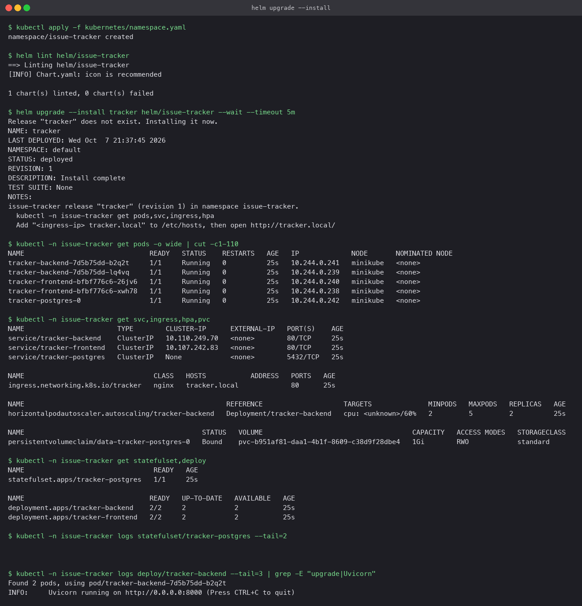
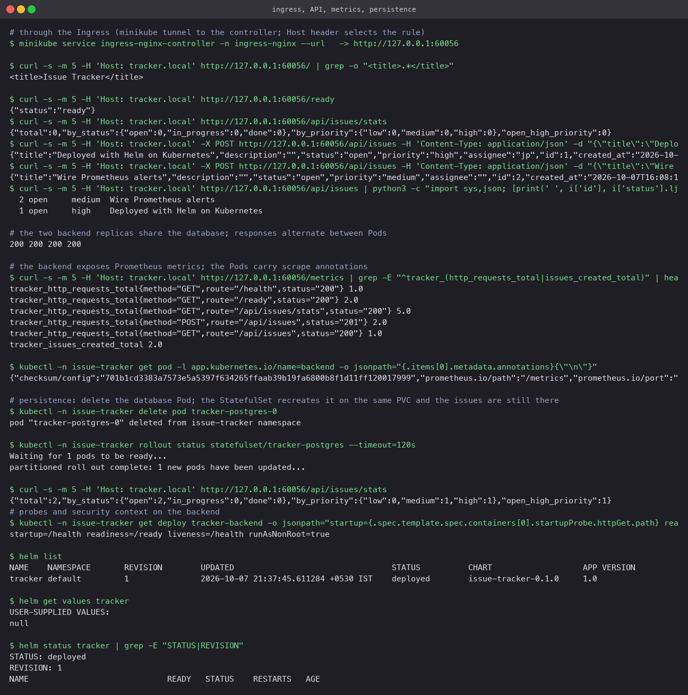
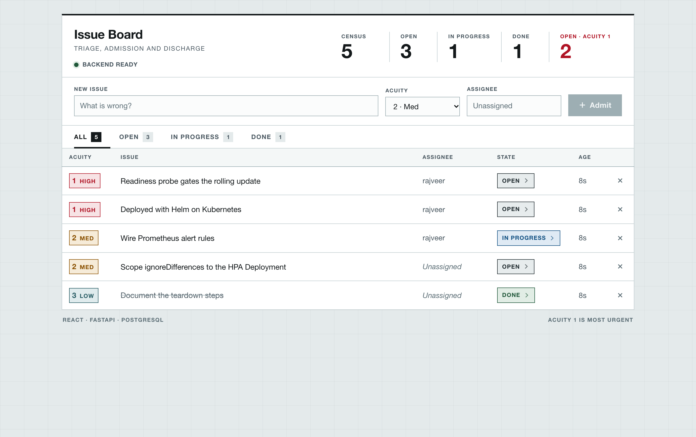

## 11. GitOps with Argo CD

`gitops/application.yaml` is an Argo CD `Application` pointing at `helm/issue-tracker` on `main`
with automated sync, prune and self-heal. Applying it made Argo CD adopt the existing release: every
object reported `Synced / Healthy`. Changing the frontend replica count in `values.yaml` and pushing
was enough to move the Deployment — no `helm` or `kubectl` command run by hand.

The lesson from the run was about ownership of the replica count:

```yaml
ignoreDifferences:
  - group: apps
    kind: Deployment
    name: tracker-backend      # scoped, not blanket
    jsonPointers: [/spec/replicas]
```

The first version applied `ignoreDifferences` to *every* Deployment, which meant Argo CD also
ignored the deliberate frontend change. GitOps and an autoscaler disagree about who owns
`spec.replicas`; the conflict has to be declared, and declared for the right object.

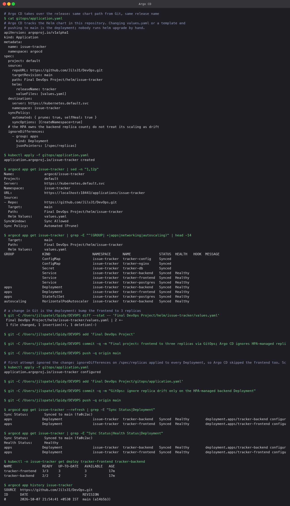

## 12. Observability: Prometheus and Grafana

`monitoring/prometheus.yaml` deploys Prometheus into the application namespace with RBAC to list
Pods and a `kubernetes_sd_configs` job that keeps only Pods annotated `prometheus.io/scrape: "true"`.
The chart puts that annotation on the backend, so every backend Pod — including ones the HPA adds
during a spike — is scraped automatically, with no edit to the scrape configuration. The autoscaler
and the monitoring are designed together: neither needs to know how many replicas there will be.

The application exposes a request counter by route and status, a latency histogram, an in-flight
gauge, and a counter of issues created. That last one is a business signal rather than an
infrastructure one, and it is what the CI smoke test asserts against.

Two alert rules, because a dashboard nobody is watching catches nothing:

- `BackendHighErrorRate` — the 5xx share stays above five percent for two minutes.
- `BackendDown` — the target disappears.

`monitoring/grafana.yaml` deploys Grafana with the Prometheus datasource and an "Issue Tracker"
dashboard provisioned from ConfigMaps: requests per second by route, p95 latency, issues created,
error rate, and the number of backend Pods being scraped. `monitoring/load-test.sh` generates the
load used to exercise the autoscaler.

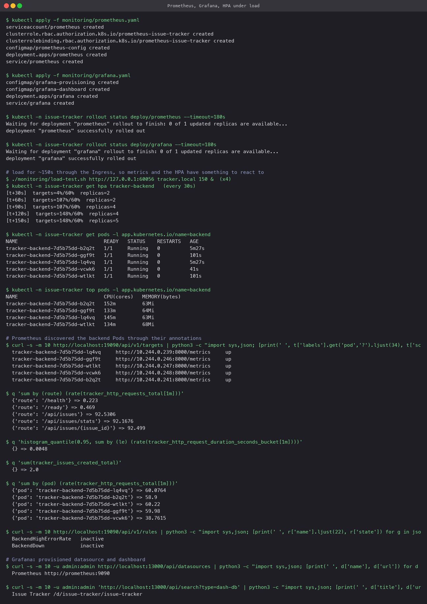
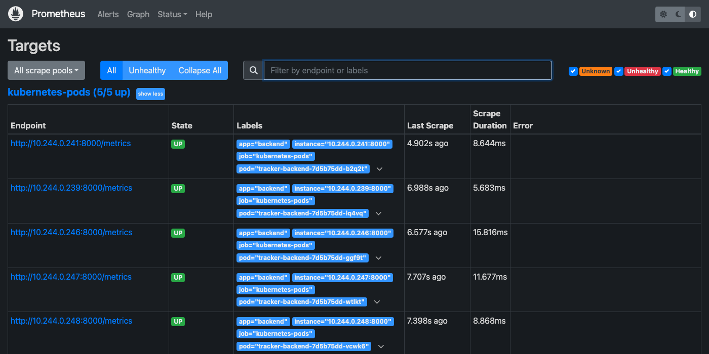
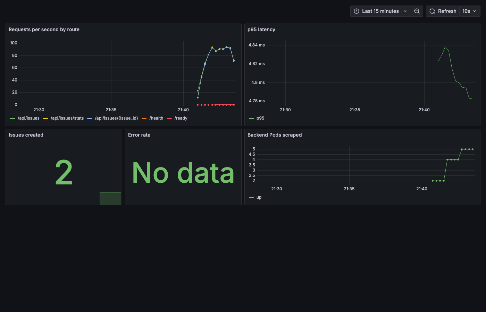

## 13. Troubleshooting drill

Two faults introduced into the running release, each diagnosed from the cluster before any fix was
applied.

| Fault | Symptom | Found with | Root cause | Fix |
|---|---|---|---|---|
| Wrong database host via a values override | Rollout stuck, new Pod `0/1`, old Pods still serving | `kubectl logs` (name resolution error), `describe` probe events, `get configmap` | `POSTGRES_HOST=tracker-postgres-typo` | `helm rollback tracker` |
| Ingress `/api` to a Service that does not exist | UI loads, every API call returns `503` | `describe ingress` names the missing Service; backend answers fine from inside the cluster | Misspelled Service name in the Ingress | Re-render the chart's Ingress |

The first fault is the one that shows why the probes are shaped the way they are: because readiness
checks the database, the new Pod never became Ready, the rolling update refused to proceed, and the
old Pods kept serving. A bad configuration change became a stuck rollout instead of an outage.

Full write-up and captures in [troubleshooting/](troubleshooting/README.md).

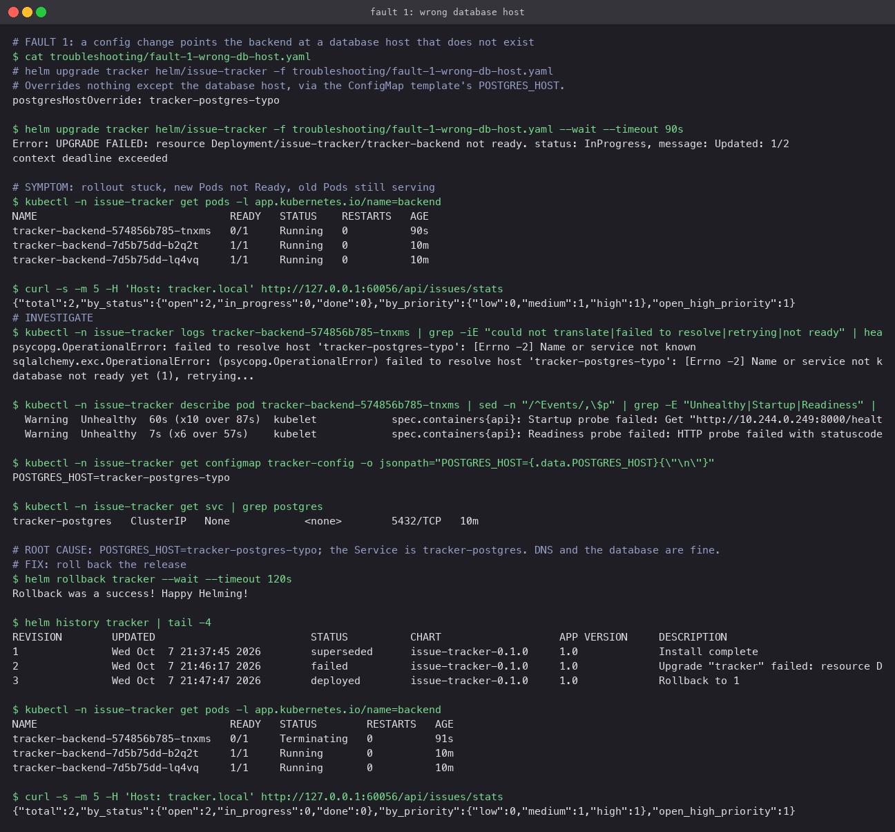
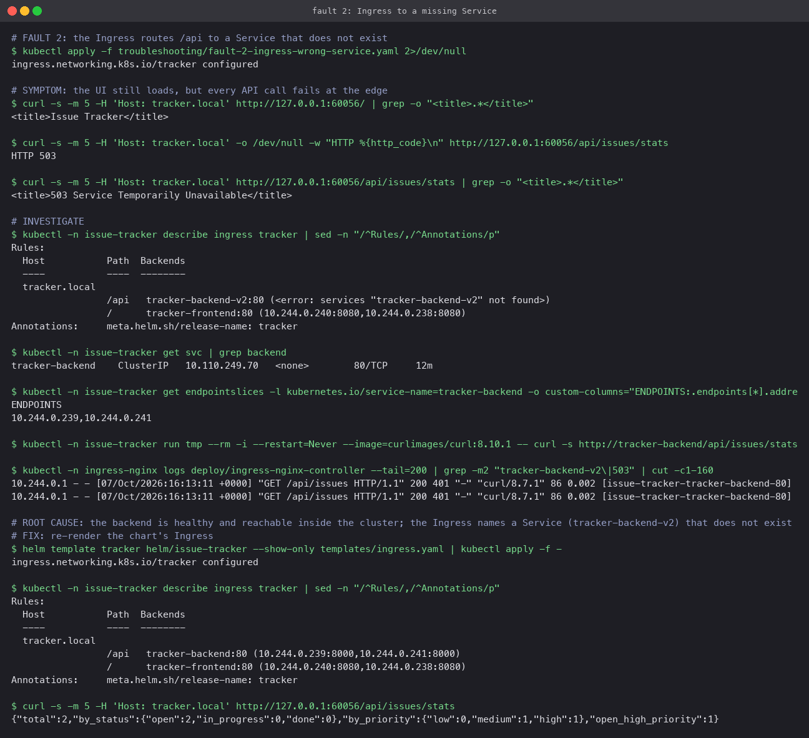

## 14. Known issues and limitations

- **EKS was not created.** The cluster for this project was Minikube. A real EKS control plane plus
  two `t3.medium` nodes and a NAT gateway costs money per session and no AWS account was available.
  The VPC project in [Cloud Terraform](../Cloud%20Terraform/02-vpc-project/) builds the network an
  EKS cluster would sit in; adding the cluster is one `module "eks"` block pointed at those subnets,
  plus `aws eks update-kubeconfig` and the same `helm upgrade --install` used here.
- **Terraform ran against LocalStack**, not real AWS. One variable (`use_localstack`) switches the
  provider; nothing else in the configuration changes. The S3 lifecycle rule is the one resource
  held back under LocalStack, because its free edition never reports the rule as applied.
- **`tracker.local` needs a hosts entry.** The Ingress matches on hostname, so
  `echo "$(minikube ip) tracker.local" | sudo tee -a /etc/hosts` is a prerequisite for the browser
  checks.
- **The HPA needs metrics-server.** On Minikube that is `minikube addons enable metrics-server`;
  without it the HPA reports unknown CPU and never scales.
- **Some screenshots in sibling folders predate this account.** The CI, shell and container captures
  in this repository have been regenerated from runs on `RAJVEER42/DevOps` and from this machine;
  a few Argo CD and cluster captures elsewhere in the repository still need to be retaken.

## 15. Screenshot index

| File | Shows |
|---|---|
| `screenshots/ci-run.png` | The pipeline run list and the job breakdown for the reference run |
| `screenshots/ci-jobs.png` | Job log excerpts: tests, both Trivy scans, the pushes, the smoke test |
| `screenshots/trivy-local.png` | A local scan of both images under the same policy as CI |
| `screenshots/helm-deploy.png` | `helm upgrade --install` and the resulting objects |
| `screenshots/verify-through-ingress.png` | The API exercised through the Ingress, including persistence |
| `screenshots/app-on-kubernetes.png` | The running UI served from the cluster |
| `screenshots/monitoring-and-hpa.png` | The autoscaler reacting to load |
| `screenshots/prometheus-targets.png` | Every backend Pod discovered and `up` |
| `screenshots/grafana-dashboard.png` | The provisioned dashboard under load |
| `screenshots/argocd-gitops.png` | Argo CD adopting the release and syncing a Git change |
| `troubleshooting/fault-1.png` | The stuck rollout and its diagnosis |
| `troubleshooting/fault-2.png` | The 503 through the Ingress and its diagnosis |

## Demo

| File | What it is |
|---|---|
| [demo/slides.pptx](demo/slides.pptx) | The presentation deck for the walkthrough |
| [demo/slides.pdf](demo/slides.pdf) | The same deck as a PDF |
| `demo/presentation.mp4` | Screen recording of the running application |

The deck is set in [Libre Franklin](https://fonts.google.com/specimen/Libre+Franklin) (SIL Open
Font License). The PDF embeds it and is correct anywhere; PowerPoint will substitute a system
face unless Libre Franklin is installed, so present from the PDF if in doubt.
